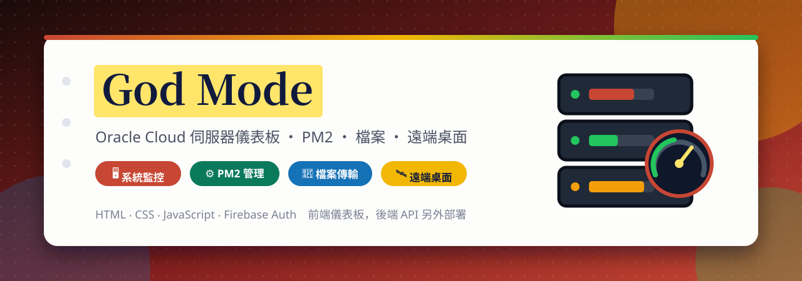
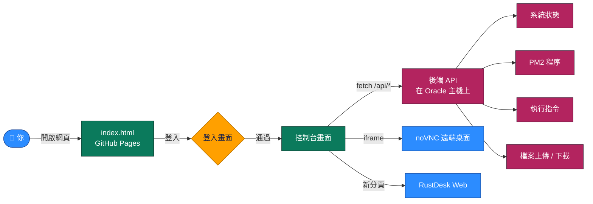

<a id="top"></a>

<div align="center">



<br>

[](https://github.com/Jiachang1112/oracle-computer)
[](https://github.com/Jiachang1112)

[](https://developer.mozilla.org/docs/Web/HTML)
[](https://developer.mozilla.org/docs/Web/JavaScript)
[](https://www.oracle.com/cloud/)
[](https://pm2.keymetrics.io/)
[](https://novnc.com/)
[](https://rustdesk.com/)
[](https://firebase.google.com/docs/auth)
[](https://fonts.google.com/)
[](https://pages.github.com/)

**一個網頁管理你的 Oracle Cloud 主機 ‧ 系統狀態 ‧ PM2 程序 ‧ 遠端指令 ‧ 檔案上傳下載 ‧ 遠端桌面**

<br>

[](#-快速開始)
[](#-特色)
[](#-後端-api)
[](#-部署)
[](#-安全注意事項)
[](#-常見問題)

</div>

---

## ✨ 特色

<table>
<tr>
<td width="33%" valign="top">

### 📊 系統狀態
即時顯示主機的使用狀況，以及目前開著的視窗與系統程序，並定時自動更新。

</td>
<td width="33%" valign="top">

### ⚙️ PM2 程序管理
列出 PM2 管理的所有服務，提供「重啟」與「停止」的快捷按鈕，並可查看即時日誌。

</td>
<td width="33%" valign="top">

### 💻 遠端終端機
在網頁上輸入指令，由主機執行並把結果顯示回來，像在 SSH 裡一樣。

</td>
</tr>
<tr>
<td valign="top">

### 📁 檔案傳輸
把檔案拖進網頁就能上傳到主機，也可以列出、下載與刪除主機上的檔案。

</td>
<td valign="top">

### 🖥️ 遠端桌面
內嵌 noVNC 畫面，也能一鍵在新分頁開啟 RustDesk 網頁版。

</td>
<td valign="top">

### 🧲 自訂版面
每張卡片都可以拖曳位置，終端機與控制面板可以調整大小。

</td>
</tr>
</table>

---

## 🧩 運作方式



- 這個倉庫**只有前端**：一個靜態的 `index.html`，透過 GitHub Pages 發佈（`CNAME` 指定自訂網域）。
- 真正做事的是跑在你的 Oracle 主機上的**後端 API**，網頁用 `fetch` 呼叫它。這個倉庫不包含後端程式。
- 後端的位址寫在 `index.html` 的 `API_BASE` 變數，換成你自己的網址即可。

### 📁 檔案說明

```text
oracle-computer/
├── index.html    控制台前端（單檔）
├── CNAME         GitHub Pages 自訂網域
└── assets/
    └── readme/   本 README 用的橫幅
```

---

## ⚡ 快速開始

**1. 下載專案**

```bash
git clone https://github.com/Jiachang1112/oracle-computer.git
cd oracle-computer
```

**2. 設定你的後端位址**

打開 `index.html`，找到並改成你自己的網址：

```js
const API_BASE = "https://你的-api-網域";
```

遠端桌面的 iframe 也一樣，把 `vnc.` 開頭的網址換成你自己的 noVNC 位址。

**3. 啟動本機伺服器**

```bash
python3 -m http.server 8000
# 打開 http://localhost:8000/
```

> 後端需要允許你的網頁來源呼叫（CORS），否則瀏覽器會擋下請求。

---

## 🔌 後端 API

前端呼叫下列介面，後端需要自行實作：

| 路徑 | 用途 |
| --- | --- |
| `GET /api/status` | 系統使用狀況 |
| `GET /api/open-windows` | 目前開啟的視窗 |
| `GET /api/system-processes` | 系統程序 |
| `GET /api/pm2` | PM2 程序清單 |
| `GET /api/pm2/{restart\|stop}/{名稱}` | 重啟／停止指定的 PM2 服務 |
| `GET /api/logs` | PM2 日誌 |
| `POST /api/cmd` | 執行指令 |
| `GET /api/files` | 列出已上傳的檔案 |
| `POST /api/upload` | 上傳檔案 |
| `GET /api/download/{檔名}` | 下載檔案 |
| `GET /api/download-any?path=…` | 下載指定路徑的檔案 |
| `DELETE /api/files/{檔名}` | 刪除檔案 |

---

## 🚀 部署

| 部分 | 做法 |
| --- | --- |
| 前端 | 開啟倉庫的 [GitHub Pages](https://pages.github.com/)（Settings → Pages → `main` 分支），並在 DNS 把網域 CNAME 指向 `jiachang1112.github.io` |
| 後端 | 在 [Oracle Cloud](https://cloud.oracle.com/) 主機上用 [PM2](https://pm2.keymetrics.io/) 常駐執行，並以 HTTPS 反向代理對外 |
| 遠端桌面 | 在主機上架設 [noVNC](https://novnc.com/)，或改用 [RustDesk](https://rustdesk.com/) |

---

## 🔐 安全注意事項

這個網頁能**在你的主機上執行指令、上傳與下載任意檔案、控制遠端桌面**，等於是主機的管理員入口，請務必謹慎：

- **登入與權限一定要在後端把關。** 網頁上的登入畫面只是介面，任何人都可以直接呼叫後端 API；後端每一支 API 都必須自行驗證身分（例如要求有效的 token），沒有通過就拒絕。
- **不要把密碼、金鑰寫在前端程式碼裡**，前端的任何內容都是公開可見的。
- **限制後端的 CORS 與來源 IP**，只允許你自己的網頁與裝置。
- **遠端桌面請加上密碼**，並用防火牆只開放必要的連接埠。
- 建議把整個服務放在 VPN 或 [Cloudflare Access](https://www.cloudflare.com/zero-trust/products/access/) 這類存取控制之後。

---

## ❓ 常見問題

<details>
<summary><b>網頁一直顯示 Waiting for authentication</b></summary>

代表還沒登入成功，或後端沒有回應。按 F12 看 Network 頁籤，確認 `API_BASE` 的網址能連線，且沒有被 CORS 擋住。

</details>

<details>
<summary><b>系統狀態、PM2 清單是空的</b></summary>

後端沒有回傳資料。到主機上用 `pm2 list` 確認後端服務有在跑，並查看後端日誌。

</details>

<details>
<summary><b>遠端桌面一片黑或載入失敗</b></summary>

確認 noVNC 服務有啟動、網址正確，且使用 HTTPS。頁面是 HTTPS 時，內嵌的 iframe 也必須是 HTTPS。

</details>

<details>
<summary><b>自訂網域無法連線</b></summary>

確認 `CNAME` 檔案內容正確、DNS 已指向 GitHub Pages，並在 Pages 設定頁勾選 **Enforce HTTPS**。

</details>

<details>
<summary><b>想換版面位置</b></summary>

按住卡片的標題列拖曳即可移動；終端機與 PM2 快捷控制器的右下角可以拖曳調整大小。重新整理頁面後會回到預設位置。

</details>

---

<div align="center">

[GitHub @Jiachang1112](https://github.com/Jiachang1112)　‧　[oracle-computer](https://github.com/Jiachang1112/oracle-computer)

[](#top)

</div>
